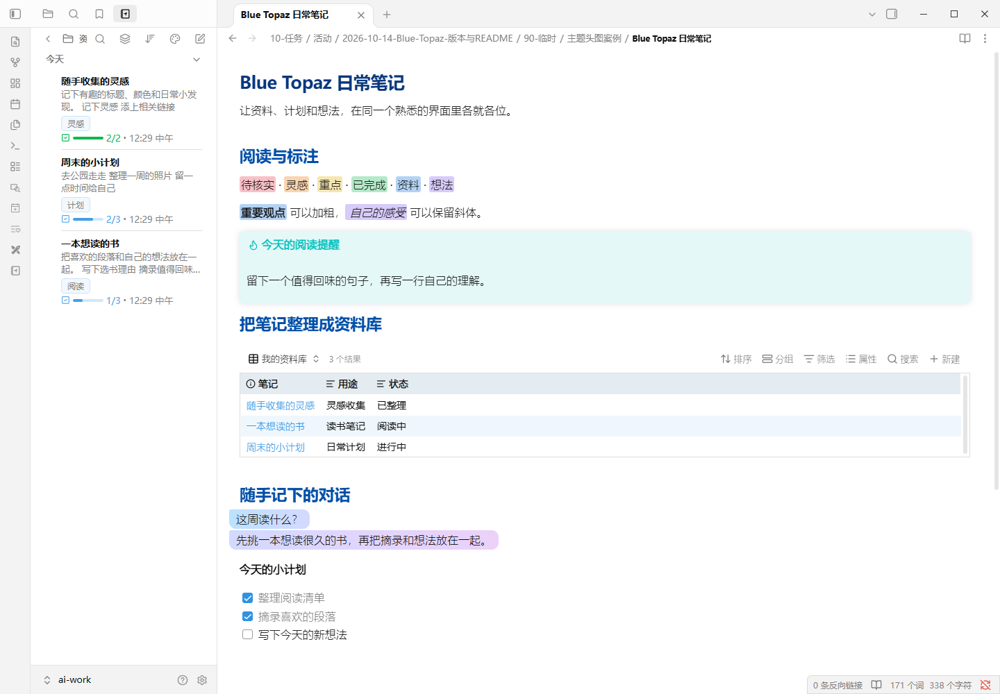
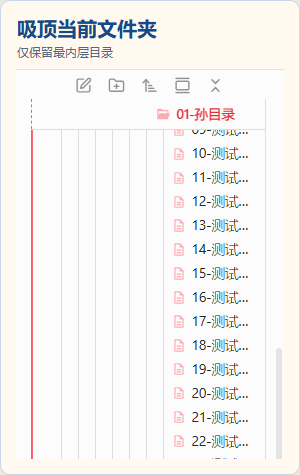
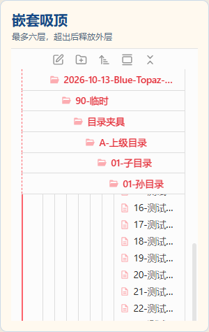

# Blue Topaz Alternate

让 Blue Topaz 在新版 Obsidian 里，继续陪你读书、整理资料和记录日常。

这是 [AiurArtanis 维护的个人 fork](https://github.com/AiurArtanis/Obsidian-Blue-Topaz-Alternate)，基于 [PKM-er / Blue Topaz](https://github.com/PKM-er/Blue-Topaz_Obsidian-css)。在原有配色与自定义选项之外，这里补充了 **Bases 资料库、聊天气泡、Notebook Navigator 导航、彩色高亮和文件夹吸顶**，也修复了一些日常使用中的显示问题。你可以通过 **Style Settings**，选择喜欢的配色、笔记布局和文件树样式。

**当前正式版本 [v1.6.0](https://github.com/AiurArtanis/Obsidian-Blue-Topaz-Alternate/releases/tag/v1.6.0)** · 支持深浅色 · [MIT](./LICENSE)

本版修正手动安装时主题无法出现在选择列表的问题，继续沿用原有 Style Settings 偏好。主题 CSS 与 **v1.5.0** 一致；具体检查范围见 Release 说明。

<picture>
  <source media="(prefers-color-scheme: dark)" srcset="./assets/readme/theme-overview-dark.png">
  
</picture>

*真实 Obsidian 窗口，使用 Blue Topaz 默认配色与专门准备的示例笔记。点击图片可查看原图。*

[新增功能](#这个-fork-增加了什么) · [安装方法](#安装当前版本) · [独立分支](#另有两个独立分支) · [上游贡献](#回馈上游的-9-条-pr)

## 这个 fork 增加了什么

### 整理笔记：Bases 表格、卡片和列表

把散落的笔记变成读书清单、项目资料或日常计划。**表格、卡片、列表**都补上了主题样式，分组标题和鼠标经过的行也更容易辨认。Obsidian 1.14.4 新增的 **Bases 看板**同样有对应样式。

### 浏览笔记：Notebook Navigator

如果你使用 **Notebook Navigator**，文件夹、笔记列表、标签、日历、工具栏和任务进度会跟随主题配色，深浅色都能保持一致。你在插件中选择的布局和自定义颜色仍然可以继续使用。

适配开关：**Style Settings → Blue Topaz → 3.12 适配Notebook Navigator**。

### 记录对话：聊天气泡

把问答、采访摘录或随手记下的对话，排成带颜色的聊天气泡。支持 `0` 到 `9` 的数字标记，并为连续气泡提供渐变配色。

在 Style Settings 中开启 **「启用聊天气泡样式」**，然后这样写：

```markdown
- [1] 这周读什么？
- [2] 先挑一本想读很久的书，再把摘录和想法放在一起。
```

### 阅读标注：六色高亮与混合格式

Obsidian 1.14.4 的 **原生六色高亮**会跟随主题。高亮中的粗体、斜体和行内代码仍保留各自的样式，连续标注的背景也更连贯；原有的 `==高亮==` 写法可以继续使用。

### 浏览文件：三种滚动方式

文件夹较多时，可以选择适合自己的浏览方式：**平滑滚动**（默认）、**吸顶当前文件夹**或**嵌套吸顶**。两种吸顶模式会把目录留在顶部，让你在向下浏览文件时仍能看见所在层级；嵌套模式最多保留六层。

开启位置：**Style Settings → Blue Topaz → 2.3.3 文件夹 → 目录层级吸顶**。这组选项用于 Obsidian 自带的文件列表。

<details>
<summary>查看两种吸顶模式与使用说明</summary>

<p align="center">
  <a href="./assets/readme/file-explorer-current.png"></a>
  <a href="./assets/readme/file-explorer-nested.png"></a>
</p>

截图来自真实文件列表。吸顶根据已展开的文件夹结构工作；不同分支深浅不一时，外层目录可能提前离开顶部。旧版 Obsidian 内核会保留原有引导线效果。已有桌面深浅色定向验证，尚未覆盖所有移动端与特殊布局。

</details>

### 提示与显示细节：跟进新版 Obsidian

- **Obsidian 1.13.4**：提示块（Callout）继续按主题显示颜色，Notebook Navigator 的新任务进度样式也有对应配色。
- **Obsidian 1.14.4**：补充悬浮提示、通知和 Bases 看板的样式，让它们与笔记界面更协调。
- **显示修复**：修正白板（Canvas）的标题对齐、手机顶部栏与安全区的样式、嵌入笔记时列表符号重叠的问题。
- **设置修复**：修正部分配色选项的无效默认值，减少调整颜色时出现异常的情况。

以上功能与修复均已包含在 **v1.5.0** 中，也包含在当前 **v1.6.0** 中。其中一些改动还在等待上游合并，具体状态见下方 PR 表。

## 安装当前版本

需要 **Obsidian 1.13.0 或以上**；使用原生六色高亮等新功能，需要 Obsidian 1.14.4 或以上。

1. 打开你的 Obsidian 笔记库，在 `.obsidian/themes/` 下新建文件夹 `Blue Topaz Alternate`。
2. 下载正式版本的 [theme.css](https://github.com/AiurArtanis/Obsidian-Blue-Topaz-Alternate/releases/download/v1.6.0/theme.css) 和同一标签下的 [manifest.json](https://raw.githubusercontent.com/AiurArtanis/Obsidian-Blue-Topaz-Alternate/v1.6.0/manifest.json)，放进这个文件夹。此版本的主题名称已与目录对齐，无需手动改名。
3. 在「设置 → 外观」选择 **Blue Topaz Alternate**。安装并启用社区插件 **Style Settings** 后，就可以调整配色、布局和功能开关。

```text
.obsidian/themes/Blue Topaz Alternate/
├── theme.css
└── manifest.json
```

Notebook Navigator 等插件需要在 Obsidian 中单独安装。更新主题时，先保留自己的自定义样式，再替换两个主题文件并重新加载。

原来在 Blue Topaz 中调好的 Style Settings 配色和开关会继续沿用，设置页仍显示 **Blue Topaz**。如果同时安装原版与 Alternate，两款主题会共用这一组偏好。

## 另有两个独立分支

- **[草稿纸 Draft Paper](https://github.com/AiurArtanis/Obsidian-Blue-Topaz-Alternate/tree/feat/draft-paper-tweak)**：暖纸色背景、深墨色正文与更柔和的标题配色，提供深浅色版本，并照顾插件中的提示、状态等颜色。对应上游 [PR #730](https://github.com/PKM-er/Blue-Topaz_Obsidian-css/pull/730)。
- **[#696 嵌套列表引导线修复](https://github.com/AiurArtanis/Obsidian-Blue-Topaz-Alternate/tree/fix/issue-696-nested-list-indent-guides)**：修正多层列表的缩进引导线显示，让层级关系更清楚。

这两项尚未合入个人主线，**不包含在 v1.5.0 中**，也不包含在 **v1.6.0** 中。如需体验，请使用相应分支的主题文件。

## 回馈上游的 9 条 PR

这个 fork 的改动也持续提交给 Blue Topaz 上游。状态核对：**2026-10-15** · **6 条已合并，3 条开放**。

| PR | 内容简介 | 合并情况 |
| --- | --- | --- |
| [#716](https://github.com/PKM-er/Blue-Topaz_Obsidian-css/pull/716) | Bases 表格与卡片样式、Autumn 配色中的表头与分组行 | 已合并 |
| [#717](https://github.com/PKM-er/Blue-Topaz_Obsidian-css/pull/717) | Bases 列表，以及分组标题和鼠标经过行的样式 | 已合并 |
| [#719](https://github.com/PKM-er/Blue-Topaz_Obsidian-css/pull/719) | 聊天气泡、连续渐变配色与设置开关 | 已合并 |
| [#720](https://github.com/PKM-er/Blue-Topaz_Obsidian-css/pull/720) | 白板标题、手机顶部栏与嵌入列表符号的显示修复（#703 / #704 / #715） | 已合并 |
| [#721](https://github.com/PKM-er/Blue-Topaz_Obsidian-css/pull/721) | Notebook Navigator 主题配色适配与总开关 | 已合并 |
| [#728](https://github.com/PKM-er/Blue-Topaz_Obsidian-css/pull/728) | Obsidian 1.13.4 提示块颜色与导航任务进度适配 | 开放 |
| [#729](https://github.com/PKM-er/Blue-Topaz_Obsidian-css/pull/729) | 修正配色选项中的无效默认值（#726） | 已合并 |
| [#730](https://github.com/PKM-er/Blue-Topaz_Obsidian-css/pull/730) | 草稿纸 Draft Paper 深浅色配色与插件颜色适配 | 开放 |
| [#734](https://github.com/PKM-er/Blue-Topaz_Obsidian-css/pull/734) | Obsidian 1.14.4 高亮、混合格式、悬浮提示、通知与看板适配 | 开放 |

<details>
<summary>版本与维护方式</summary>

个人版本使用 `v1.<minor>.<patch>`：新功能或大范围适配递增第二位，局部修复递增第三位。它与上游 `manifest.json` 的日期版本独立。

`src` 镜像上游 `master`；个人 `master` 集成已完成的适配与修复。功能开发保留独立分支，个人 README 与上游主题贡献分别维护。

最早保留的 Bases 功能线完成快照标为 `v1.0.0`，到 `v1.5.0` 的 10 个历史标签已补齐，保留原有指向，不补历史 Release。

尚未完成跨端交叉测试的版本使用 `v1.<minor>.<patch>-preview`，在 GitHub 标记为 **Pre-release**，供其他端先取得主题文件。完成交叉测试后，从经过验证的主线版本创建去掉 `-preview` 的正式标签与新 Release，不覆盖既有正式标签。

[Release](https://github.com/AiurArtanis/Obsidian-Blue-Topaz-Alternate/releases) 只上传对应标签的 **theme.css**。GitHub 自动生成的源码归档仍由平台提供。

</details>

## 用法与致谢

- [Blue Topaz 上游主题](https://github.com/PKM-er/Blue-Topaz_Obsidian-css)：完整主题文档、更新与社区入口。
- [中文 TIPS Vault](https://github.com/PKM-er/Blue-Topaz_Obsidian-css/blob/master/TIPS%20vault/TIPS%20for%20Blue%20Topaz_Chinese.zip) · [English TIPS Vault](https://github.com/PKM-er/Blue-Topaz_Obsidian-css/blob/master/TIPS%20vault/TIPS%20for%20Blue%20Topaz_English.zip)：下载示例笔记库，看看主题的各种用法。
- [@cumany 的增强示例库](https://github.com/cumany/Blue-topaz-examples)：更多笔记与主题实践。

感谢 WhyI、PKMer 与 Blue Topaz 社区的维护与分享。聊天气泡的早期参考来自 AnuPpuccin 与已有 CSS snippet；个人 fork 的贡献见上方 PR 表。

Partial style(s) is(are) sourced or adapted from Blue Topaz (https://github.com/PKM-er/Blue-Topaz_Obsidian-css), and I would like to express my appreciation to WhyI (https://github.com/whyt-byte) and pkmer.cn (https://pkmer.cn).

[MIT License](./LICENSE) · Copyright (c) 2020 whyt-byte
